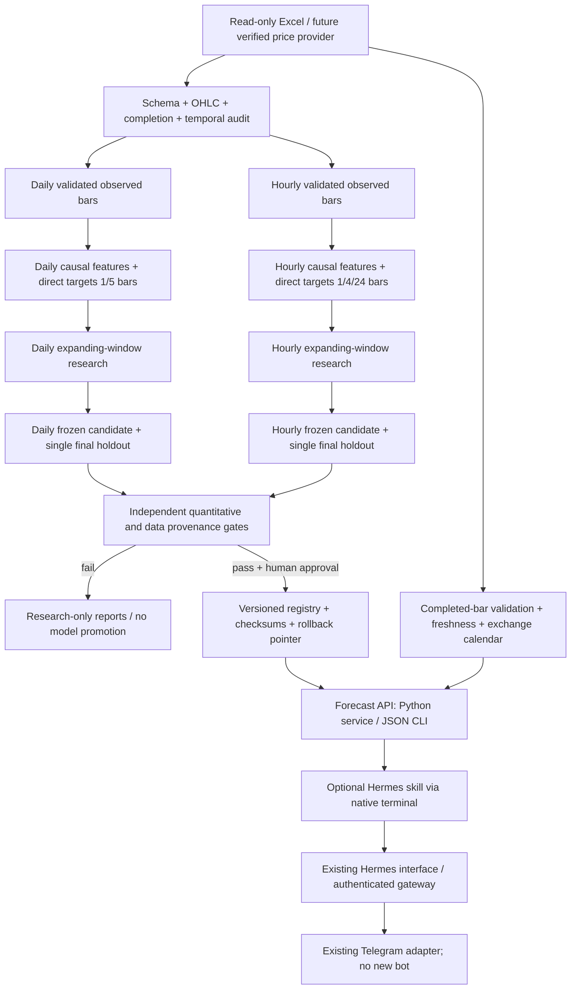

# Platinum forecasting: evidence before promotion

## Intent and scope
Implement the supplied research brief as a Hermes extension, with independent
daily and hourly experiments. Native prices are Yahoo PL=F front-month futures
in USD/troy ounce; USD/kg columns are deterministic conversions, not features.
Do not describe this instrument as spot XPT/USD. No trading, new bot, paid
resources, core Hermes changes, or production activation is authorized here.

## Selected architecture
A local, separately packaged `platinum_forecasting` component provides a typed
forecast contract and a CLI. A proposed optional Hermes skill calls the CLI via
the existing terminal tool. This follows Hermes's CLI + skill extension ladder,
avoids permanent core tool schemas, and needs no additional HTTP server or auth
surface. Forecast API means a Python/JSON contract here. Existing gateway
authentication and Telegram routing remain responsible for message access.
An HTTP microservice adds operational overhead; a new core tool adds per-call
schema cost. Neither is justified before a model passes the evidence gates.

## Research protocol frozen before final scores
- Separate data and configurations; no cross-frequency feature joins.
- Holdout: last 20% of cleaned ordered rows, fixed by index and timestamp in
  a manifest before selection. Three expanding validation windows span the
  preceding 30%. Initial fit uses the first 50%. Purge h origins at each
  boundary so training target timestamps precede validation origins.
- A sample at origin t uses a fully observed bar and predicts close at t+h
  observed bars in the same conservative continuity segment. Never fabricate
  bars. Hourly segments break at any interval other than one hour. Daily
  segments break above four calendar days. These are conservative research
  policies, not an authoritative exchange calendar.
- Exclude malformed OHLC, invalid prices/volumes, conflicting duplicates,
  off-hour snapshots and the final potentially incomplete source bar. Preserve
  original file and a SHA-256 digest. Do not repair prices or fill gaps.
- Compete random walk, seasonal naive, rolling drift, moving average,
  ARIMA(1,0,0) on returns, regularized return/price linear models, and direct
  boosted return models. Fit preprocessing only within training folds.
- Optuna: eight trials per dataset/horizon, three folds, one CPU thread per
  estimator. Fixed seeds. No GPU or external data. Deep networks deferred:
  only two years of hourly observations and weak provenance do not justify
  a large search. No claim of exhaustive/global model optimality.
- Freeze chosen candidate, hyperparameters, features, validation baseline,
  calibration residuals, and acceptance thresholds before final evaluation.
- Gate per horizon: >=5% MAE improvement over strongest validation-selected
  baseline on holdout; positive lower bound of one-sided 95% moving-block
  bootstrap loss improvement (Bonferroni across five horizon decisions);
  beat baseline in >=2/3 validation folds; no fold MAE ratio >1.10; >=200
  holdout samples; empirical 90% interval coverage >=85%; leakage tests pass.
- Production also requires verified completed-bar timestamps, roll methodology,
  usable publication/license terms, exchange calendar, current data provider,
  human approval and functional inference/integration checks. These data
  provenance gates cannot be inferred from an Excel label.
- Final failure ends promotion. No retuning from final scores. Intervals use
  absolute validation residuals scaled by origin price (finite-sample quantile);
  they are empirical intervals, not a promised coverage or confidence percent.

## Boundaries and failure behavior
`data_audit.py`: read-only ingestion and deterministic quarantine.
`features.py`: causal per-frequency transforms, shared train/inference code.
`validation.py`: purged splits, scores and block bootstrap.
`model_research.py`: candidate factories, fold-only training and tuning.
`experiment.py`: frozen manifests, holdout ledger and reproducible reports.
`forecast_service.py`: injected provider, safe JSON artifacts and fail-closed
promotion/freshness/schema checks. `cli.py`: transport only.

Artifacts and raw data live outside the Git checkout. Reports and source enter
the feature branch; raw financial data, fitted binary objects and credentials
do not. No pickle/joblib deserialization in serving. A failed model produces
status and evaluation reports, never a synthetic current forecast.
